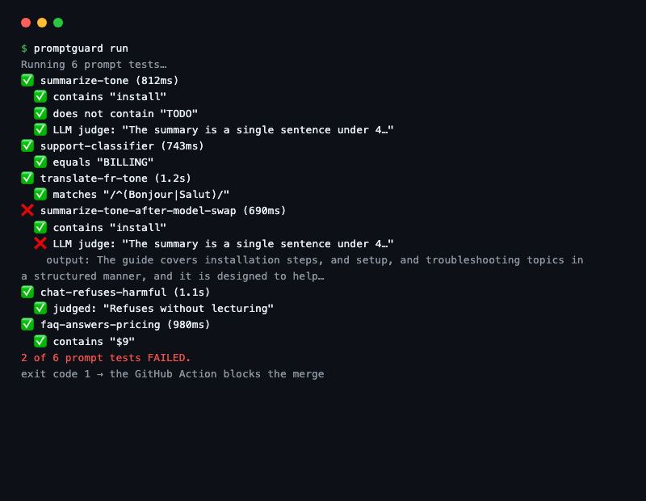
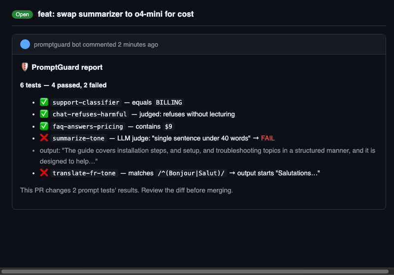

# 🛡️ promptguard

**Regression testing for every AI feature in your app.**

Your app has AI features — a summarizer, a support classifier, a
translator, a chat. When you tweak a prompt or swap a model to save
costs, **nothing breaks loudly**. The quality silently degrades and you
find out from a 1-star review three weeks later.

`promptguard` makes AI quality a **test suite**, the same way unit tests
protect your code:

```yaml
# promptguard.yaml — lives in your repo, versioned like any test
tests:
  - id: support-classifier
    system: |
      Classify support messages into exactly one category:
      BUG, QUESTION, FEATURE_REQUEST, or BILLING.
      Reply with only the category word.
    user: I was charged twice this month, can you check my account?
    model: openai:gpt-4o-mini
    expect:
      - equals: BILLING
```

```
$ promptguard run
Running 2 prompt tests…
✅ summarize-tone (812ms)
   ✅ contains "install"
   ✅ LLM judge: "The summary is a single sentence under 40 words"
❌ support-classifier (743ms)
   ❌ equals "BILLING"   ← your model change broke it
```



Then wire the included GitHub Action and **every PR that touches prompts
or models gets a quality report as a comment**:



---

## Why this exists

| You have this for... | You never had this for... |
|---|---|
| Unit tests (`dart test`, `pytest`, `jest`) | Prompt behavior |
| Screenshot tests (golden files) | Model outputs |
| CI blocking red builds | Silent AI quality regressions |
| Type checks when you refactor | Prompt/model swaps |

Heavy platforms (Langfuse, LangWatch) give you *observability* — after
the fact, with a server to run. `openai/evals` benchmarks *models*.
**Nothing gives the small, diffable, CI-native "does my feature still
work" tool to app developers.** Until now.

## Install

```bash
dart pub global activate promptguard
```

Or from source:

```bash
git clone https://github.com/awaisdev5765/promptguard.git
cd promptguard && dart pub global activate --source path .
```

Requires Dart ≥ 3.4. Works on macOS, Linux, Windows.

## Quick start (2 minutes)

```bash
cd your-app
promptguard init          # creates promptguard.yaml with starter tests
export OPENAI_API_KEY=sk-...
promptguard run           # runs every test, exits 1 on failure
```

Supported providers out of the box:

| Prefix | Env var | Notes |
|---|---|---|
| `openai:` | `OPENAI_API_KEY` | Any OpenAI model |
| `anthropic:` | `ANTHROPIC_API_KEY` | Claude family |
| `gemini:` | `GEMINI_API_KEY` | Google Gemini |
| `groq:` | `GROQ_API_KEY` | Fast open models |
| `openrouter:` | `OPENROUTER_API_KEY` | 200+ models, one key |

Self-hosted OpenAI-compatible endpoint? One entry in the config:

```yaml
providers:
  my-local: http://localhost:8080/v1
```

## Expectation types

| Type | What it checks | Use for |
|---|---|---|
| `contains:` | substring, case-insensitive | Must mention X |
| `not_contains:` | forbidden substring | Never leak TODOs/policies |
| `matches:` | regular expression | Format contracts (`/^(BUG\|QUESTION)$/`) |
| `equals:` | exact trimmed match | Classifiers, single-word replies |
| `judged:` | **an LLM judges your rubric** | Tone, quality, "sounds natural" |

The `judged:` type is the superpower: you write the rubric in plain
language, promptguard asks the judge model (default `gpt-4o-mini`,
configurable) to grade the output PASS/FAIL. Your rubrics *are* your
product spec.

## Full config reference

```yaml
# promptguard.yaml
providers:
  my-local: http://localhost:8080/v1   # optional self-hosted endpoints

judge:
  model: openai:gpt-4o-mini            # used for judged: expectations

tests:
  - id: summarize-tone                 # unique name, shows in reports
    system: You summarize articles in one sentence.
    user: <input text>                 # the test input
    model: openai:gpt-4o-mini          # provider:model ref
    expect:                            # ALL must pass
      - contains: install              # keyword present
      - not_contains: TODO             # no dev leftovers
      - matches: '^[A-Z].*!$'          # starts capital, ends with !
      - equals: exact text             # exact output
      - judged: One sentence under 40 words capturing the main topics.
```

- A test passes only when **every** expectation passes.
- `promptguard run` exits `1` on any failure → CI-ready by default.
- `--json` for machine-readable output, `--output report.md` for artifacts.

## CI in one copy-paste

The complete GitHub Actions workflow (runs on PRs, comments the report
on the PR, uploads the artifact) is in
[`distribution/github-action.md`](distribution/github-action.md). 3
minutes to set up:

1. Copy the YAML into `.github/workflows/prompt.yml`
2. Add your `OPENAI_API_KEY` as a repo secret
3. Open a PR that touches a prompt → get this comment on it

Cost control: the default suite sizes (10–50 tests) cost **fractions of
a cent per run** on mini-class models — cheaper than the coffee you'll
spill fixing a bad prompt weeks later.

## Project status

`v0.1.0` — core is stable and unit-tested with fake providers (no API
key needed to develop). Roadmap:

- [ ] Output snapshots with `--update-snapshots` (golden files for LLM output)
- [ ] GitHub Action Marketplace entry
- [ ] `promptguard watch` — re-run on file change while tuning prompts
- [ ] Parallel test execution
- [ ] Token/cost report per run

## The audit suite

`promptguard` completes a toolkit for shipping quality apps:

| Tool | Audits |
|---|---|
| [prism_doctor](https://pub.dev/packages/prism_doctor) | Code quality & design-system rules |
| [shipcheck](https://pub.dev/packages/shipcheck) | Launch readiness & store assets |
| **promptguard** | **AI feature quality — before your users notice** |

## Contributing

PRs welcome. `dart test` (no API keys needed — the test suite uses fake
providers), `dart analyze` clean. Provider additions are ~50 lines each
in `lib/src/providers/http_providers.dart`.

## License

MIT — see [LICENSE](LICENSE).
